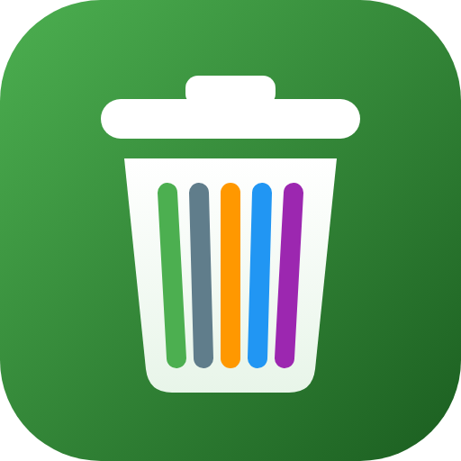

<p align="center"></p>

# Waste Collection

[](https://github.com/hacs/integration)
[](https://github.com/Banzamel/Waste-Collection/releases)

Home Assistant integration + dashboard card for your waste collection schedule: bio, mixed, plastic, paper and glass. Each tile counts down the days to the next pickup and lights up when it's today or tomorrow.

## Install

1. HACS → ⋮ → **Custom repositories** → add `https://github.com/Banzamel/Waste-Collection` as **Integration**
2. Search **Waste Collection** in HACS → **Download** → restart Home Assistant
3. Settings → Devices & Services → **Add Integration** → **Waste Collection**
4. Edit a dashboard → **Add card** → **Waste Collection** (or `type: custom:waste-collection-card`)

Requires Home Assistant 2024.7 or newer. To update: HACS → Waste Collection → **Update** → restart → refresh the browser (Ctrl+Shift+R).

## Add pickup dates

- **📅 on the card** — pick a waste type and date → **Add** · ✕ removes an entry
- **📥 ICS import** — the calendar file from your municipality's website. The waste type is recognised from the event name (`bio`, `plastic`, `paper`, `glass`, `mixed` and similar)
- **📥 JSON import** — a list of pickups, see [example_collection_date.json](custom_components/waste_collection/example_collection_date.json):

  ```json
  { "pickups": [ { "type": "bio", "date": "2026-03-06" }, { "type": "glass", "date": "2026-03-27" } ] }
  ```

- **Services** — `waste_collection.add_pickup`, `waste_collection.remove_pickup`, `waste_collection.update_schedule` (replaces the whole list)

## Entities

| Entity | Value |
|---|---|
| `sensor.waste_collection_next` | date of the nearest pickup (`description` attribute: e.g. "Bio, Mixed") |
| `sensor.waste_collection_<type>` | days until the next pickup of that type |
| `sensor.waste_collection_schedule` | number of pickups (list in attributes) |
| `binary_sensor.waste_collection_today` / `_tomorrow` | on when anything is collected today / tomorrow |
| `binary_sensor.waste_collection_<type>_today` / `_tomorrow` | the same for one type |
| `calendar.waste_collection` | all pickups as calendar events |

`<type>` is `bio`, `mixed`, `plastic`, `paper` or `glass`. Values refresh at midnight.

Example — reminder the evening before:

```yaml
automation:
  - alias: Waste collection reminder
    trigger:
      - platform: time
        at: "19:00:00"
    condition:
      - condition: state
        entity_id: binary_sensor.waste_collection_tomorrow
        state: "on"
    action:
      - service: notify.notify
        data:
          message: >
            Put out: {{ state_attr('binary_sensor.waste_collection_tomorrow', 'description') }}
```

## Notes

- Data is stored in `/config/.storage/waste_collection.storage` — back it up, it survives updates and reinstalls.
- Card not showing after an update? Refresh with Ctrl+Shift+R (in the mobile app: Settings → Companion App → Debugging → Reset frontend cache).
- A sensor showing `unknown` means no future pickups of that type are scheduled.
- Card and UI are in English and Polish (follows your Home Assistant language).
- Changes in each version: [Releases](https://github.com/Banzamel/Waste-Collection/releases).

## License

MIT — see [LICENSE](LICENSE). Not affiliated with Home Assistant.
